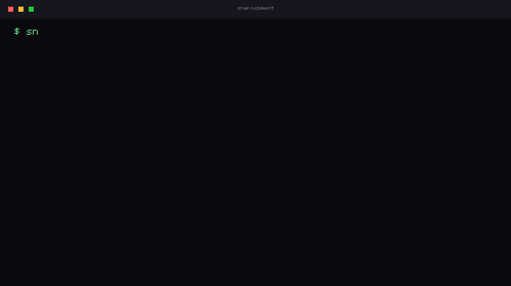

# Snap Judgment

[](https://github.com/littlestjames82-sys/snap-judgment/actions/workflows/ci.yml)
[](https://www.python.org/)
[](LICENSE)

**Your screenshots, reviewed.** Snap Judgment reads a folder of screenshots and issues a courtroom-style verdict on your screenshot habits: a tier, the evidence, awards, and a sentence.



Meet [the defendants](gallery/README.md): five synthetic screenshot collections, from The Minimalist (35 screenshots, acquitted) to The Hoarder (2,800, Unrepentant Screenshot Felon), judged and entered into the record. New presiding voices live in [judges/](judges/README.md), and the version record is kept in the [changelog](CHANGELOG.md).

## Install

```
pip install snap-judgment
```

Pure Python standard library. No dependencies, Python 3.9+.

## Usage

```
snapjudgment ~/Pictures/Screenshots
snapjudgment ~/Desktop ~/Pictures --card card.html --out report.md
snapjudgment ~/Pictures --svg card.svg   # SVG share card (1200x630)
snapjudgment ~/Pictures --png card.png   # PNG share card (1200x630), rendered with the stdlib alone
snapjudgment ~/Pictures --html page.html # full self-contained HTML report
snapjudgment ~/Downloads --all           # judge every image in the folder
snapjudgment ~/Pictures --since 2024-01-01  # only screenshots on or after a date (a bare year works too)
snapjudgment ~/Pictures --until 2026-06-30  # only screenshots on or before a date
snapjudgment ~/Pictures --year 2026      # judge one single year only
snapjudgment ~/Pictures --vs ~/Phone     # co-defendant mode: compare two folders
snapjudgment ~/Pictures --vs-year 2026   # compare one year against another year in the data
snapjudgment ~/Pictures --judge strict   # strict | fair | lenient presiding judge
snapjudgment ~/Pictures --judge-file poet.json  # a custom judge voice from a JSON pack
snapjudgment ~/Pictures --intensity roast  # court commentary at full roast (0-100 or gentle|kind|honest|spicy|roast)
snapjudgment ~/Pictures --wrapped-kit ./kit     # year-scoped SVG card + ready-to-post drafts
snapjudgment ~/Downloads --court downloads  # the downloads docket: a second court, for the downloads folder
snapjudgment ~/Pictures --cleanup-list cleanup.txt  # the cleanup order: the exact files a plea bargain would remove
snapjudgment ~/Pictures --plea-bargain   # the hypothetical verdict if you deleted the old and the duplicated
snapjudgment ~/Pictures --rematch        # compare this hearing with the last one on record
snapjudgment ~/Pictures --badge badge.svg  # a shields-style verdict badge for your README
snapjudgment ~/Pictures --fail-above "Repeat Offender"  # exit 1 if the verdict ranks above this tier
snapjudgment ~/Pictures --oneline        # print exactly one summary line
snapjudgment ~/Pictures --csv files.csv  # per-file records as CSV
snapjudgment --history                   # print the court record of prior hearings
snapjudgment ~/Pictures --json           # machine-readable verdict
```

With no folder argument, Snap Judgment checks the usual places
(`~/Pictures/Screenshots`, `~/OneDrive/Pictures/Screenshots`, `~/Desktop`,
`~/Pictures`, `~/Downloads`) and judges the first one that actually
contains screenshots.

The verdict tiers run from **Innocent Bystander** (under 50 screenshots) up
to **Unrepentant Screenshot Felon** (2,500+). Along the way the court weighs
the evidence: total count and size, the largest single screenshot, date
span, busiest day, month and hour, night share, weekend share, evidence
retention (how much of the collection is over a year old), screenshots per
day, median per active day, silent months (whole calendar months inside the
span with zero screenshots), longest daily streak, longest clean stretch,
biggest 60-second burst, the busiest hour window (the fullest rolling 60
minutes anywhere in the record), duplicate suspects and the storage they
waste, the per-format share (PNG, JPG, HEIC...), your busiest screenshot
season, your screenshot anniversary (the month-day you shoot most, summed
across years), and the device eras told by your screen resolutions. The
Markdown and HTML reports also draw a screenshot heatmap: the whole
collection as an hour-by-weekday grid. `--since` and `--until` narrow the
record to a date range (inclusive, and they compose with `--year`); the
active filter is entered into the evidence. Files the court cannot
read (broken symlinks, locked files) are counted and reported, never fatal.

With 5 or more screenshots the report also presents **exhibits**: the five
oldest screenshots, entered into evidence as Exhibit A through Exhibit E.
When several folders are judged in one run, an evidence block lists each
folder with its screenshot count.

With 10 or more screenshots the court also reads **the charges**: a census
of where the screenshots came from, from metadata hints only. Android
filenames that carry an app package are credited to that app (WhatsApp,
Telegram, Instagram, and friends); everything else is classified by the
form factor its dimensions suggest, from Phone (tall) to Desktop /
landscape.

Three judges can preside. The **fair** judge is the default. The **strict**
judge (The Hanging Judge) words the same verdict severely, and the
**lenient** judge (The Sympathetic Judge) frames everything kindly, with
encouragement instead of a sentence. The voice changes the wording only,
never the math.

Add `--intensity` and the court appends a line of commentary after the
sentence, aimed at your most damning stat: night share first, then sheer
count, duplicate extras, your longest streak, the oldest evidence. The
intensity runs 0-100 or by name: gentle, kind, honest, spicy, roast. At
gentle the court simply notes that the defendant keeps late hours; at
full roast it finds the sleep schedule guilty too. Commentary is opt-in,
appears in the terminal report, JSON, and the Markdown and HTML reports,
and composes with any judge. Like the judge's voice, it changes the
wording only, never the math. It can also live in the config file as
`intensity`.

### Custom judge packs

`--judge-file FILE.json` seats a judge of your own. A pack is a JSON object:

```json
{
  "name": "The Poet",
  "intro": "The Poet presides over {count} screenshots.",
  "sentences": {
    "Innocent Bystander": "A short poem of a folder."
  },
  "award_lead": "The court pins these medals:"
}
```

`name` is required; `intro` (which may use `{tier}` and `{count}`),
`sentences`, and `award_lead` are optional. Any verdict tier missing from
`sentences` falls back to the fair judge's sentence for that tier. A
complete example, **The Poet**, ships at `examples/judge-poet.json`. With
`--json`, the report's `judge` field carries the pack's name. A malformed
pack exits with code 2 and a plain message.

A pack may also carry an `awards` object that renames awards by their
stable keys (`night_owl`, `burst_mode`, `screenshot_streak`, and the
rest; every award in the JSON report now carries its `key`). Each entry
may override the display `name`, the `evidence` line, or both; the
evidence is a template filled with the award's own stat values, so
`"{night_count} hoots at {night_share:.1f}%."` renders with the real
numbers. Entries keyed by an unknown award are warned about and
ignored. **The Critic** (`judges/judge-critic.json`) shows the feature
off: a dry film-critic judge whose Night Owl is entered into the record
as *Nocturne in a Minor Key*.

### Configuration file

Options you reach for every time can live in a `.snapjudgment.toml`.
Snap Judgment looks for one in the current directory first; when exactly
one folder is given and the current directory has none, a config file
inside that folder applies. Command-line flags always override the file.

```toml
# .snapjudgment.toml
folders = ["~/Pictures/Screenshots"]
judge = "strict"
plea_years = 3
fail_above = "Repeat Offender"
all = false
```

The supported keys are `folders` (a list of paths, used when no folder
argument is given), `judge` (`strict` | `fair` | `lenient`),
`judge_file` (a custom judge pack, as with `--judge-file`),
`plea_years` (an integer), `fail_above` (a verdict tier name),
`all` (a boolean), `intensity` (an integer 0-100 or a band name,
as with `--intensity`), and `court` (`screenshots` | `downloads`). Python 3.11+ parses the file with `tomllib`; on
3.9/3.10 a small built-in parser reads the same flat subset of TOML
(top-level `key = value` lines). A config file that cannot be parsed,
names an unknown judge or tier, or points at a judge pack that does not
load is warned about on stderr and ignored as a whole: a config file
must never break a run.

### Shell completions

Completion scripts for bash and zsh live in
[`completions/`](completions/): they complete every flag, with judge
voices for `--judge` and verdict tiers for `--fail-above`. For bash,
copy `completions/snapjudgment.bash` into your bash-completion
directory (e.g. `~/.local/share/bash-completion/completions/snapjudgment`)
or source it from `~/.bashrc`. For zsh, copy
`completions/snapjudgment.zsh` as `_snapjudgment` into a directory on
your `$fpath` and run `compinit`.

### Year over year

`--vs-year 2026` compares one year against the most recent year present in
the data (or, when the target is the most recent year, against the previous
year present): counts, verdict tiers, night shares, and sizes per year,
plus a closing line noting improvement, relapse, or no change in behavior.

### The plea bargain

`--plea-bargain` asks what a cleanup would buy you, without touching a
single file. The court computes the hypothetical outcome if you deleted
(a) every duplicate suspect except one keeper per exact size-and-dimension
group, and (b) every screenshot older than `--plea-years N` years
(default 2), measured from the newest screenshot in the folder: how many
files would go, how much space would come back, and what verdict the
remainder would earn. If the projected tier beats the real one, the court
would accept the plea; if not, it notes for the record that the plea
changes nothing. It is a projection, labeled as such - Snap Judgment
never deletes, moves, or modifies anything it judges.

`--cleanup-list FILE` turns the plea into paperwork: it writes the
exact files the plea bargain would remove (duplicate extras plus
screenshots older than `--plea-years`), one sorted path per line under
a `#` header giving the count and bytes, and enters a `cleanup_order`
object into the JSON report. It needs no `--plea-bargain` flag, and
when both are given they always agree, because they are the same
computation. The court issues the order; it does not swing the axe
itself. What you do with the list is your business.

### The downloads docket

`--court downloads` convenes a second court for the folder where good
intentions go to be forgotten. It judges the folder given on the
command line, or `~/Downloads` when none is given, and it judges
*every* file on the surface, any type, non-recursively, from names,
sizes, and dates only. No file is ever opened.

The evidence is the downloads folder's own: total files and size,
installers (`.exe`, `.msi`, `.dmg`, `.pkg`, `.deb`, `.rpm`,
`.appimage`) and archives, duplicate downloads (the `setup.exe`,
`setup (1).exe`, `setup (2).exe` chains, counted by extra copies), the
oldest and largest files, an extension census, and the share of files
over a year old. The verdict tiers are the docket's own:

| Files | Verdict |
|---|---|
| 0 | No Evidence |
| 1-24 | Tidy Desk |
| 25-99 | Mild Clutter |
| 100-249 | Digital Junk Drawer |
| 250-499 | Landfill Adjacent |
| 500-999 | Hoarding Situation |
| 1,000+ | Superfund Site |

Its awards are its own too: **Installer Archaeologist** (10 or more
installers), **Zip Hoarder** (15 or more archives), **Double
Downloader** (5 or more duplicate extra copies), **Ancient Relic**
(the oldest file is at least 3 years old), **Gigabyte Landfill** (5 GB
or more in total), **Still Seeding** (a `.torrent` file), **Receipt
Keeper DX** (an invoice or receipt in a filename), and **Time
Capsule** (60% or more of the files are over a year old). The
terminal report, `--json`, `--out`, `--oneline`, `--fail-above`
(against the docket's tiers), `--judge`, `--intensity` (with
commentary written for downloads sins), the share cards (`--card`,
`--svg`, `--png`, headed THE DOWNLOADS DOCKET), `--badge` (colored by
the docket's own ladder), the full HTML report (`--html`),
`--rematch` against the last downloads hearing, `--year`,
`--wrapped-kit`, `--csv` (one row per file, categorized as installer,
archive, or other), the `--since` / `--until` date filters, and the
court record all work in this court. Only the comparisons (`--vs`,
`--vs-year`), the plea bargain, the cleanup order, and judge packs
(`--judge-file`) are refused with a plain error, because they belong
to the screenshots court's evidence. A sample hearing is at
`examples/downloads-demo-output.txt`. `--court` can also live in the
config file.

### Rematch

`--rematch` tries this hearing against the last one on record for the
same folders: the count delta since that hearing and whether the verdict
has improved, worsened, or held since. With no prior hearing for the
folders, the court says so. In JSON the comparison rides along as a
`rematch` object (or `null` when there is nothing to rematch against).

### A badge for your README

`--badge badge.svg` writes a shields-style verdict badge: a dark
"snap judgment" segment and the tier on a segment colored by severity,
green for Innocent Bystander through to dark red for Unrepentant
Screenshot Felon. Post your card, wear your verdict.

The share cards carry the word too: the HTML, SVG, and PNG cards print a
small `pip install snap-judgment` line under the footer, so anyone who
sees your verdict knows how to get one of their own.

### The wrapped kit

`--wrapped-kit DIR` scopes the hearing to the current year (or to `--year`
when given) and writes two files into DIR: `wrapped-YYYY.svg`, the year's
share card, and `post.txt` with two ready-to-post drafts built only from
the review's own numbers: a short post of at most 280 characters and a
standard post with the verdict, count, size, and top awards. If the year
has no screenshots, nothing is written and the exit code is 2.

### Failing a build on a verdict

`--fail-above TIER` exits 1 when the actual verdict ranks above TIER in the
tier order, and 0 otherwise. Tier names are case-insensitive and accept
spaces or hyphens (`"Repeat Offender"`, `repeat-offender`). An unknown tier
exits 2 and prints the valid tier list. The report (or JSON) is still
printed first, so the flag drops straight into CI.

### One line

`--oneline` prints exactly one line and nothing else:

```
Repeat Offender · 310 screenshots · 15.1 MB · Jan 2024 - Nov 2026
```

Card, CSV, and report files are still written when their flags are given.
With `--json`, JSON wins and `--oneline` is ignored. An empty folder prints
`No Evidence · 0 screenshots` and exits 2.

## GitHub Action

Snap Judgment ships as a composite GitHub Action. It installs the package
from this repo, judges a folder, and appends the Markdown verdict to the
workflow step summary:

```yaml
- uses: littlestjames82-sys/snap-judgment@v0.5.0
  with:
    path: ./screenshots
    judge: fair          # optional: strict | fair | lenient
    fail-above: "Repeat Offender"  # optional: fail the step above this tier
```

Inputs: `path` (required), `judge` (default `fair`), `fail-above`
(optional). The step's exit code is Snap Judgment's own, so `fail-above`
can fail the step.

Every hearing is entered into the **court record** at
`~/.snap-judgment/history.jsonl`. The next time a folder is judged, the
verdict reports the last hearing's count and whether the collection is up
or down since, and `--rematch` puts the two hearings side by side.
`snapjudgment --history` prints the full record.

## The verdicts

| Screenshots | Verdict |
|---|---|
| 0 | No Evidence |
| 1-49 | Innocent Bystander |
| 50-199 | Petty Offender |
| 200-499 | Repeat Offender |
| 500-999 | Habitual Hoarder |
| 1,000-2,499 | Felony-Level Archivist |
| 2,500+ | Unrepentant Screenshot Felon |

## The awards

- **Night Owl** - a quarter or more of your screenshots happen between 10 PM and 5 AM
- **The 3 AM Club** - 10 or more screenshots taken between 2 AM and 4 AM
- **Burst Mode** - 8 or more screenshots inside a single 60-second window
- **The Archivist** - your oldest screenshot is at least 3 years old
- **Receipt Keeper** - half or more of your shots are weekday 9-to-5 evidence
- **Repeat Customer** - 10 or more files are exact size-and-dimension duplicates of a sibling
- **Creature of Habit** - a quarter or more of your screenshots fall in a single hour of the day
- **Gigabyte Club** - your screenshots total a gigabyte or more of evidence
- **Time Traveler** - at least one screenshot is dated in the future; the court admits it anyway
- **The Long Haul** - the collection spans 4 or more years
- **Lifer** - the collection spans 8 or more years
- **Ancient Relic** - the oldest screenshot sits 10 or more years before the newest
- **Anniversary** - one month-day accounts for 15 or more screenshots across the years
- **Screenshot Streak** - 7 or more consecutive days with at least one screenshot
- **Clean Stretch** - 30 or more consecutive days without a single screenshot; a recorded moment of restraint
- **Minimalist** - under 50 screenshots total; the court's rare acquittal

## Sample output

From a synthetic demo folder of 310 screenshots (see `examples/` for the
full report, the HTML, SVG, and PNG share cards, a wrapped-kit example, and
the example judge pack):

```
THE VERDICT
  Repeat Offender
  310 screenshots, 15.1 MB of evidence,
  spanning Jan 5, 2024 to Nov 10, 2026.

THE EVIDENCE
  Total screenshots              310
  Total size                     15.1 MB (15,799,537 bytes)
  Taken at night (10 PM-5 AM)    91 (29.4%)
  Busiest hour window            12 screenshots in the hour from Aug 14, 2026 21:14
  Formats                        PNG 100%
  Screenshot season              Summer (Jun-Aug) - 31.0%
  Screenshot anniversary         Aug 14 - 14 screenshots across 2 years

THE CHARGES
  Desktop / landscape            157 (50.6%)
  Phone (tall)                   153 (49.4%)

EXHIBITS
  Exhibit A - Screenshot 2024-01-05 at 17.59.50.png (Jan 5, 2024)
  Exhibit B - Screenshot 2024-01-12 at 11.46.18.png (Jan 12, 2024)
  Exhibit C - Screenshot 2024-01-17 at 07.08.34.png (Jan 17, 2024)
  Exhibit D - Screenshot 2024-01-21 at 22.29.11.png (Jan 21, 2024)
  Exhibit E - Screenshot 2024-01-22 at 14.04.37.png (Jan 22, 2024)

AWARDS
  * Night Owl - 91 screenshots between 10 PM and 5 AM (29.4% of the total).
  * The 3 AM Club - 32 screenshots taken between 2 AM and 4 AM, when nothing on screen can be urgent.
  * Burst Mode - 12 screenshots inside a single 60-second window.
  * Repeat Customer - 12 files share an exact size and dimensions with a sibling. The same screenshot, taken again.
  * Screenshot Streak - 10 consecutive days with at least one screenshot.

THE SENTENCE
  Sentence: probation. The screenshots folder gets a check-in once a month.
```

## Privacy

Snap Judgment works from **file metadata only**. It reads file names, sizes,
modification times, and - solely to learn an image's width and height - the
header bytes of the image file. It never decodes image pixels, never runs
OCR, and never uploads anything anywhere. What your screenshots show is your
business; how many there are is the court's.

## License

MIT. Copyright Ryan Cotten / Ghost Developer Studio.
