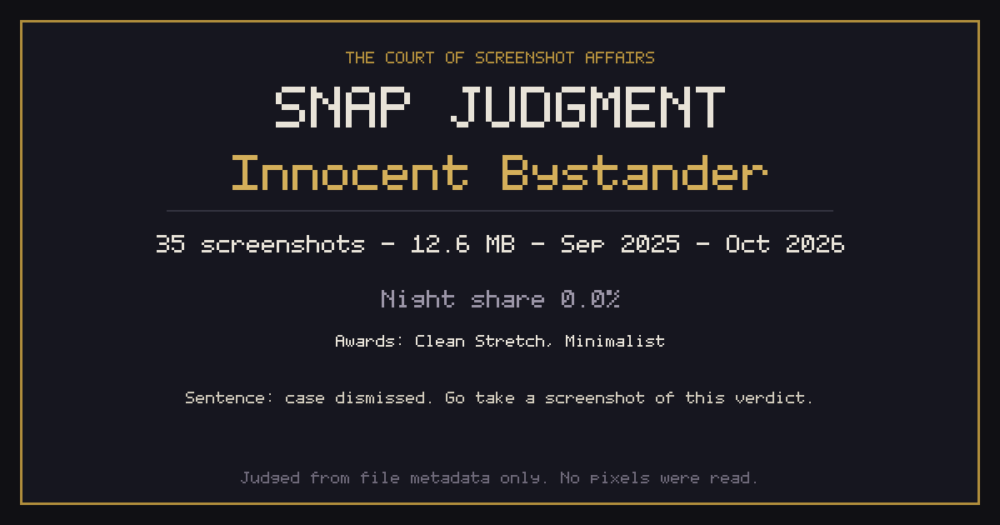
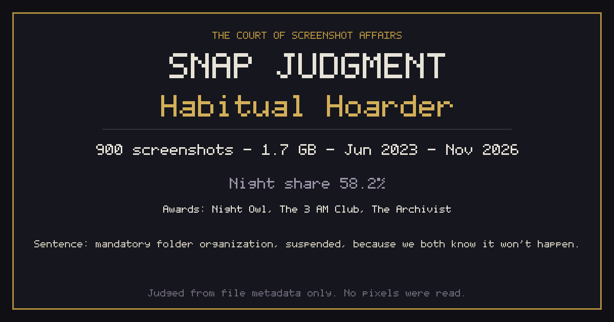
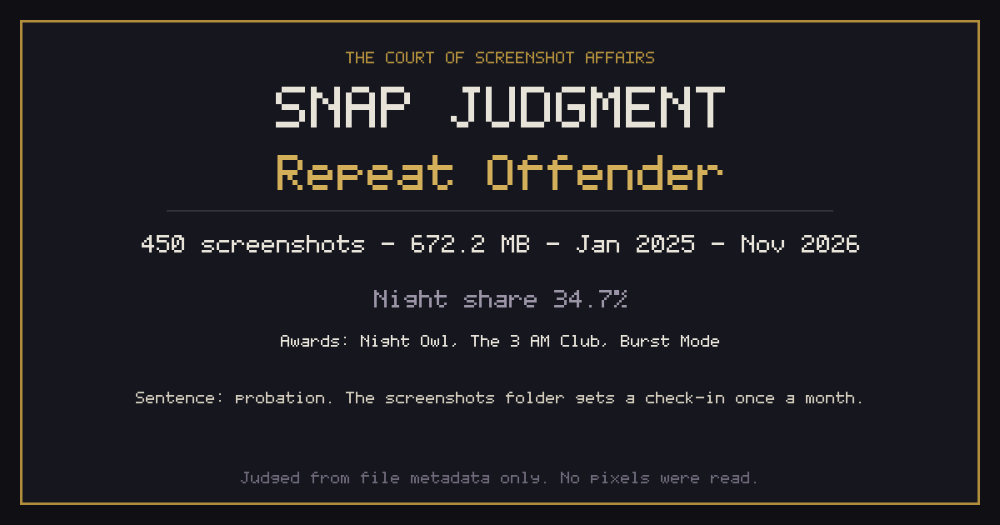
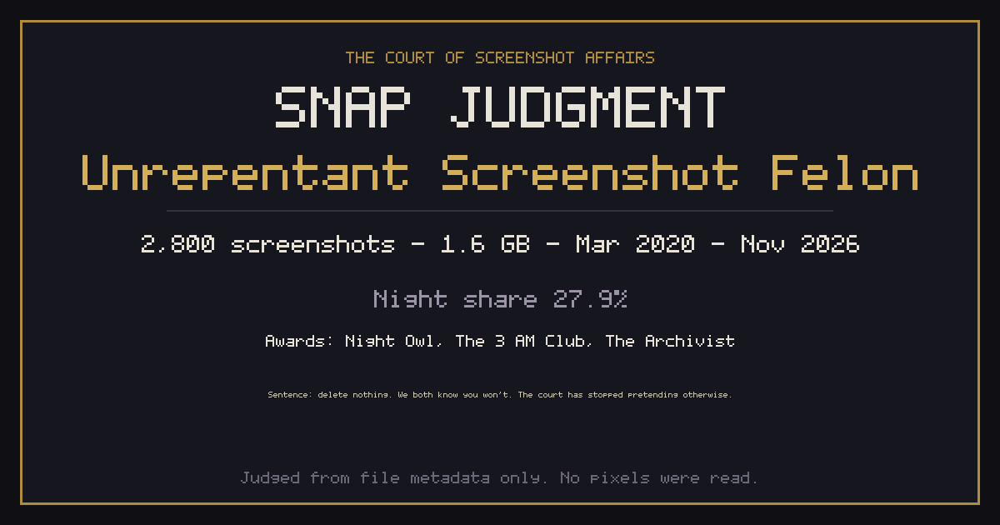
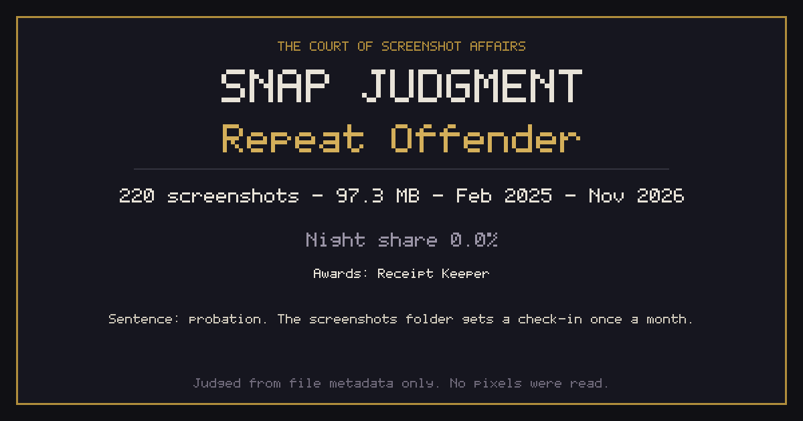

# The Defendants: five screenshot collections, formally judged

Every defendant below is a synthetic screenshot collection with a
fixed personality, generated by `tools/make_gallery.py` from fixed
seeds and judged by Snap Judgment itself, in UTC, with the court's
clock stopped at November 19, 2026. No real person's screenshots
were involved. Several defendants would like to appeal.

| Defendant | Screenshots | Size | Verdict | Signature award |
| --- | --- | --- | --- | --- |
| [The Minimalist](the-minimalist.md) | 35 | 12.6 MB | Innocent Bystander | Minimalist |
| [The Night Archivist](the-night-archivist.md) | 900 | 1.7 GB | Habitual Hoarder | Night Owl |
| [The Burst Photographer](the-burst-photographer.md) | 450 | 672.2 MB | Repeat Offender | Burst Mode |
| [The Hoarder](the-hoarder.md) | 2,800 | 1.6 GB | Unrepentant Screenshot Felon | Repeat Customer |
| [The Receipt Keeper](the-receipt-keeper.md) | 220 | 97.3 MB | Repeat Offender | Receipt Keeper |

## The Minimalist

Thirty-five screenshots in fourteen months, all in daylight. The court had to check the folder was the right one.

[Full report](the-minimalist.md) - 35 screenshots, 12.6 MB, verdict **Innocent Bystander**.

## The Night Archivist

Nine hundred screenshots over three years, sixty percent of them between 10 PM and 5 AM. The archive keeps its own hours.

[Full report](the-night-archivist.md) - 900 screenshots, 1.7 GB, verdict **Habitual Hoarder**.

## The Burst Photographer

A moderate folder, except for the twenty-five occasions on which twelve screenshots happened inside a single minute.

[Full report](the-burst-photographer.md) - 450 screenshots, 672.2 MB, verdict **Repeat Offender**.

## The Hoarder

Six years, twenty-eight hundred screenshots, and hundreds of them taken twice. Deleting is not on the docket.

[Full report](the-hoarder.md) - 2,800 screenshots, 1.6 GB, verdict **Unrepentant Screenshot Felon**.

## The Receipt Keeper

Every screenshot a weekday, every one between nine and five. This folder is not a habit; it is a filing system.

[Full report](the-receipt-keeper.md) - 220 screenshots, 97.3 MB, verdict **Repeat Offender**.

*Generated by Snap Judgment. `pip install snap-judgment` and judge your own folder.*
